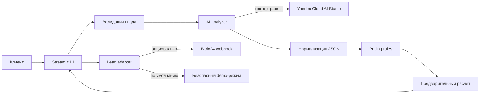

# AI Jewelry Valuation

> **Мультимодальный MVP для предварительной оценки золотых ювелирных изделий по фотографии.**
> Проект создан для хакатона по кейсу **ООО «СКС Ломбард»**.

[Демо приложения](https://airouu-hackathon.streamlit.app/) · [Стек](#стек) · [Запуск](#локальный-запуск) · [Тесты](#тесты)

## Зачем нужен сервис

Потенциальному клиенту ломбарда приходится приходить в офис, не понимая ориентировочную сумму займа. Сервис сокращает этот барьер: клиент загружает до четырёх фотографий украшения, указывает известные характеристики и сразу получает **объяснимый предварительный расчёт**. После этого он может выбрать отделение или заказать обратный звонок.

> Это не автоматическое решение о выдаче займа. Окончательную оценку выполняет товаровед при очном осмотре.

## Что реализовано

- **Мультимодальный AI-анализ** фотографий: тип изделия, состояние, вставки, дефекты и диапазон веса.
- **Детерминированный расчёт** по тарифной сетке для проб `375`, `585`, `750`; правила расчёта вынесены из интерфейса.
- **Объяснимая оценка вероятности приёма**: результат сопровождается причинами, а критичные дефекты дополнительно проверяются эвристикой.
- **Конверсионный сценарий**: выбор отделения или заявка на обратный звонок.
- **CRM-адаптер**: безопасный demo-режим без передачи персональных данных и опциональный webhook Bitrix24.
- **Защита пользовательского пути**: валидация количества и размера фото, номера телефона и согласия на обработку контактов.
- **Отказоустойчивый demo-режим**: без ключей облака приложение честно показывает расчёт по анкете и не маскирует его под AI-анализ.

## Пользовательский сценарий

1. Пользователь принимает уведомление о предварительном характере оценки.
2. Загружает от 1 до 4 фотографий украшения и заполняет анкету.
3. Приложение получает структурированный ответ модели и нормализует его.
4. Расчётный модуль определяет сумму займа, условия выкупа и вероятность приёма.
5. Пользователь видит результат, ограничения оценки и может оформить обращение.

## Архитектура



### Принципы реализации

| Зона | Решение |
| --- | --- |
| Ненадёжный ответ LLM | JSON извлекается из ответа, проверяются допустимые значения, строки `"false"` корректно интерпретируются как `False` |
| Ошибка внешнего AI API | Приложение не падает: переключается на расчёт по анкете с явным предупреждением |
| Персональные данные | Телефон нормализуется, согласие обязательно, в demo-режиме контакты не отправляются наружу |
| Деньги | Расчёт использует `Decimal` и явное банковское округление |
| CRM | Интеграция отделена адаптером; включается только через `BITRIX_WEBHOOK_URL` |
| XSS из ответа модели | Динамический текст, попадающий в HTML-блоки, экранируется |

## Стек

- **Python 3.10+**, **Streamlit**
- **Yandex Cloud AI Studio** / OpenAI-compatible API
- **Qwen3.6-35B** для мультимодального анализа
- **Bitrix24 REST webhook** (опционально)
- `unittest` для регрессионных тестов бизнес-логики

## Структура репозитория

```text
.
├── app.py                 # Streamlit-интерфейс и пользовательские сценарии
├── analyzer.py            # Вызов AI, извлечение и нормализация JSON
├── pricing.py             # Тарифы и объяснимая оценка вероятности приёма
├── bitrix.py              # Адаптер demo/Bitrix24 CRM
├── config.py              # Типизированные настройки из окружения
├── tests/                 # Регрессионные тесты расчёта и нормализации AI-ответа
├── .env.example           # Шаблон конфигурации без секретов
└── requirements.txt
```

## Локальный запуск

```bash
# 1. Клонировать репозиторий
 git clone https://github.com/a1rou/hackathon.git
 cd hackathon

# 2. Создать и активировать окружение
 python -m venv .venv
 source .venv/bin/activate       # macOS / Linux
 # .venv\Scripts\activate        # Windows PowerShell

# 3. Установить зависимости
 pip install -r requirements.txt

# 4. Добавить конфигурацию (AI и CRM опциональны)
 cp .env.example .env

# 5. Запустить
 streamlit run app.py
```

Без `YC_API_KEY` и `YC_FOLDER_ID` интерфейс запускается в демонстрационном режиме. Для включения AI-анализа добавьте значения в `.env`:

```dotenv
YC_API_KEY=your_yandex_cloud_api_key
YC_FOLDER_ID=your_yandex_cloud_folder_id
```

Для интеграции с Bitrix24 задайте **полный URL метода** `crm.deal.add`:

```dotenv
BITRIX_WEBHOOK_URL=https://your-portal.bitrix24.ru/rest/1/webhook-token/crm.deal.add.json
```

Перед включением CRM нужно создать соответствующие пользовательские поля `UF_*` в Bitrix24 либо адаптировать маппинг в `bitrix.py`.

## Тесты

```bash
python -m unittest discover -s tests -v
```

Тесты покрывают тарифный расчёт, пограничные условия и нормализацию потенциально неконсистентных ответов модели.

## Ограничения MVP и следующие шаги

- Вес по фото приблизительный: для точной суммы нужен очный осмотр или весы.
- Сейчас поддерживаются только золотые изделия и три пробы.
- Тарифы заданы в коде; в production их следует перенести в управляемый источник с версионированием.
- Для production необходимы аудит действий, rate limiting, хранение согласий и полноценная модель CRM-контакта.
- Следующая продуктовая итерация: A/B-тестирование формы, карта отделений и метрики конверсии «оценка → обращение → визит».

## Автор

**Ислибаев Родион Станиславович** — разработка продукта, AI-интеграция, расчётный модуль, CRM-адаптер и интерфейс.

- Telegram: [@airouuu](https://t.me/airouuu)
- Email: airouu.kai@gmail.com
